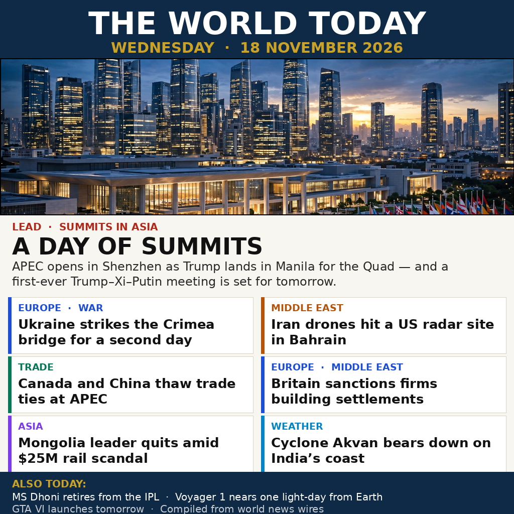

# makefun-news-image-20261118

[](https://make.fun/bounty/news-image-20261118?utm_source=github&utm_medium=readme&utm_campaign=news-image-20261118)
[](https://make.fun/bounty/news-image-20261118/leaderboard?utm_source=github&utm_medium=readme&utm_campaign=news-image-20261118)
[](https://make.fun/bounty/news-image-20261118?utm_source=github&utm_medium=readme&utm_campaign=news-image-20261118)

**THE WORLD TODAY — Wednesday 18 November 2026.** One image that sums up
the day's world news as a newspaper front page: the masthead names the day,
the lead story is the day of summits (APEC opens in Shenzhen, Trump lands in
Manila for the Quad, and a first-ever Trump–Xi–Putin meeting is set for
tomorrow), and six cards cover the rest — Ukraine's second-day strike on the
Crimea bridge, Iranian drones hitting a US radar site in Bahrain, the
Canada–China trade thaw at APEC, Britain's sanctions on settlement firms,
Mongolia's leader quitting amid a $25M rail scandal, and Cyclone Akvan
bearing down on India's coast. The footer adds Dhoni's IPL retirement,
Voyager 1 nearing one light-day from Earth, and GTA VI launching tomorrow.

## The image



`entry.png` is 1024×1024, 666,561 bytes. The lead photograph (a summit
conference hall under a dusk skyline) was generated for this entry; every
word on the page is drawn with DejaVu so it stays crisp and legible at any
size. All stories were checked against the day's reporting before the image
was drawn.

## Run it

```sh
mkdir -p out && MAKEFUN_OUTPUT_DIR=out python3 main.py
# writes out/entry.png — byte-identical on every run, no network
```

## Files

- `main.py` — the entrypoint: copies `entry.png` to `/output/entry.png`
- `entry.png` — the front page itself
- `LICENSE` — MIT
